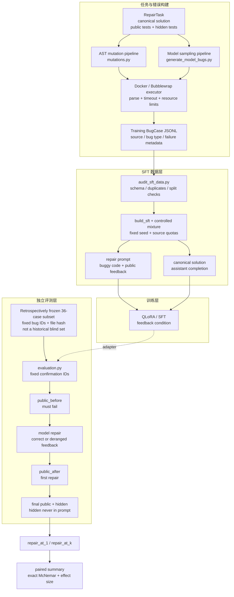
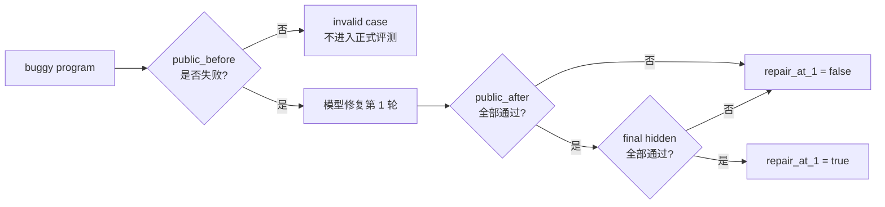

# Code Repair 实验设计独立审计

审计日期：2026-10-31
审计范围：任务/错误生成、筛选清洗、SFT 数据、Mixed 与 AST-only 对照、评测指标、McNemar 检验、split 隔离与可复现性。
审计原则：先分析现有数据和实现；不生成新数据、不启动训练、不修改评分标准、不修改原有实验数据。

## 1. 结论摘要

代码实现的基本实验链路是清楚且可复现的：canonical solution 经过 AST 或模型生成错误，错误先用公开测试筛选；SFT prompt 包含公开执行反馈，completion 是 canonical solution；评测先确认 bug 的公开测试失败，再让模型修复，最后同时检查公开和隐藏测试。

`repair_at_1` 的实现没有发现把“只通过公开测试”误算为成功的错误：它要求第一轮修复通过公开测试，并且最终隐藏测试全部通过。`exact_mcnemar_p` 也正确实现了配对二项分布的双侧精确检验。

当前实验最大的风险不是指标代码，而是因果解释：历史 AST-only 与 Mixed 的错误分布不同，旧结果不能直接解释为“执行反馈导致的提升”。新增的 `audit_ast_control.py` 已把边界/逻辑/运行时的数量对齐到 Mixed 目标，但它仍主要匹配 bug type 总量，尚未匹配原始任务、变异家族、公开失败签名、隐藏测试难度和每任务 bug 上限。因此这是一个更好的数量控制，不是完全公平的困难度控制。

### 后续实现核对（2026-11-23）

本报告记录的是 2026-10-31 的独立审计快照；随后代码有未覆盖在原审计中的改动。核对当前工作树后，原报告中“通用验证不检查 hidden-fail”的问题已由双套件门槛修复：`command_generate_bugs`、`command_validate` 和 `command_build_sft` 现在要求 reference 的 public/hidden 均通过、候选 bug 的 public/hidden 均失败；评测也拒绝 public-before 已通过的无效 bug。新增执行结果校验会区分基础设施错误与候选超时，并记录评测输入、配置、源码和输出哈希的 manifest。对应测试覆盖了 hidden-pass bug 拒绝和评测数据来源追踪。

这项修复有明确边界：双套件筛选只应作用于训练 split 自己的任务；隐藏测试的逐项内容/失败信息不会写入模型 prompt 或 bug metadata。不得把确认集/测试 split 的 hidden 结果拿来筛选训练样本、挑模型或调参。更大的研究限制仍在：AST-only/Mixed 的错误难度与任务分层未完全匹配，已有 36 例确认子集是事后追溯冻结，并非历史盲测。

## 2. 项目架构图



实线是数据或调用流，虚线表示训练后的 adapter 被送入评测。图中 36 例是从既有主评测集追溯冻结的子集，并非训练前建立的历史盲测或独立任务集；它只能作为确认性复核。其 hidden tests 只交给执行器，不进入模型。`audit_sft_data.py` 和 `audit_ast_control.py` 是证据层，不能替代模型评测。

### `repair_at_1` 的双测试门槛



`repair_at_1` 要求第一轮 public 通过且 final hidden 通过；只通过 public 或只完成多轮修复，都不能被写成一次修复成功。

### 数据与信任边界

| 内容 | 模型是否可见 | 使用阶段 | 审计要求 |
|---|---:|---|---|
| buggy code、题目描述、公开测试反馈 | 是 | SFT 与推理 | prompt 必须与对应 bug、task 一致 |
| canonical solution | 仅 SFT completion 可见 | 训练 | 不得进入评测 Prompt |
| public tests | 结果可见，测试实现按数据格式管理 | 筛选与评测 | public-before 必须失败；public-after 决定是否继续 |
| hidden tests 与执行结果 | 否 | 最终评测 | 不得进入 Prompt 或数据选择反馈环 |
| bug type、source、mutation metadata | 通常不应进入模型答案 | 分层抽样与分析 | 用于公平对照，不能被事后重标以改善结果 |
| 现有 36 例追溯冻结 IDs/hash | 否 | 结果复核 | 已固定但不是历史盲测，不能包装成独立 confirmation set |
| 未来独立 confirmation IDs/hash | 否 | 最终确认 | 必须在训练、超参选择和结果查看之前冻结，并与开发任务隔离 |

## 3. 现有执行链

### 3.1 原始任务与错误生成

- 当前 `src/repairbench/cli.py` 的 `command_generate_bugs` 先要求 canonical solution 通过 public/hidden，再仅保留 public/hidden 都失败的 AST mutation。只把公开失败记录写入 bug metadata。
- `scripts/generate_model_bugs.py:103` 加载任务并从模型采样代码；`public_result` 在第 163 行执行，公开通过即丢弃；第 168 行再跑隐藏测试，隐藏通过也丢弃。
- 模型 bug 的 `bug_type` 在 `scripts/generate_model_bugs.py:174` 根据**公开测试失败**分类：全是 AssertionError 才叫 logic，否则 runtime/timeout。隐藏失败不会重新校正标签。
- `src/repairbench/executor.py` 提供 Docker、Bubblewrap 和显式允许的本地执行；发布/审计路径应使用隔离执行器。

### 3.2 公开/隐藏验证与 SFT

- 当前 `src/repairbench/cli.py` 的 `command_validate` 检查 reference 两套通过、bug 两套均失败；执行器基础设施错误不会静默算成候选 bug。
- 当前 `command_build_sft` 再次验证 reference 和 bug 的两套测试，只把 public feedback 放进 prompt，并将 canonical solution 作为 completion。
- `scripts/audit_sft_data.py` 检查 JSONL、entry point、重复测试、public/hidden 测试交集、bug 引用、未修改 completion、重复行和跨 split task/prompt 签名。
- `scripts/build_controlled_mixed_sft.py` 以 bug ID 去重、排除重复 prompt、按固定 seed 抽样并打乱；输出 manifest 记录来源与数量。

### 3.3 评测与指标

- `src/repairbench/evaluation.py:59` 的 `evaluate_case` 先跑 `public_before`，再构造修复 prompt，允许模型多轮修复；公开测试全部通过时提前停止，然后运行最终公开和隐藏套件。
- `src/repairbench/evaluation.py:117` 定义：`repair_at_1 = first_repair_success and final_hidden.all_passed`；`repair_at_k = final_public.all_passed and final_hidden.all_passed`。
- `ExecutionResult.all_passed`（`src/repairbench/schemas.py:119`）要求 runner completed、total > 0 且 passed == total，因此空测试集不会被算作通过。
- `src/repairbench/evaluation.py:127` 汇总总体和按 bug type 结果。
- `scripts/analyze_paired_results.py:33` 的 `exact_mcnemar_p` 用较小 discordant count 的精确二项分布计算双侧 p 值；`compare_pair` 第 79 行先检查 bug ID 和 bug type 配对一致，再比较 outcome。

## 4. 已确认的正确性

### 4.1 `repair_at_1` 计算

**结论：实现正确，且比只看 public_after 更严格。**

第一轮是否“修好”由公开测试决定，但最终成功还必须隐藏测试全部通过。隐藏测试从不进入 repair prompt，因此指标不会因为把隐藏答案泄露给模型而虚高。

需要注意语义：`repair_at_1` 是“第一轮公开测试通过且最终隐藏通过”，不是“模型只产生一次 token/一次 API 调用”；它适合报告一次修复尝试成功率。

### 4.2 McNemar 检验

**结论：核心数学实现正确，实验解释仍需控制比较数量。**

`exact_mcnemar_p(left_only, right_only)` 对 discordant 样本使用精确双侧二项概率，适用于同一 bug ID 的配对二元结果。`compare_pair` 检查两边 bug ID 集合一致，避免把未配对的 case 当成 paired test。

当前脚本对多组 run 和多个 metric 做多次 pairwise 比较，没有内置 Holm/Bonferroni/FDR 校正；因此单个接近 0.05 的 p 值不应直接称为显著。实验报告应预注册主要比较和校正方法。

### 4.3 执行反馈是否真的进入训练

数据脚本构造的 SFT 行把 buggy solution 和 public feedback 放在 prompt，canonical solution 放在 completion；`audit_sft_data.py` 对 prompt/completion/task/bug 的对应关系进行检查。反馈 derangement 在 `src/repairbench/evaluation.py:21` 生成固定 seed 的无固定点循环移位，用来检验正确反馈是否有贡献。

## 5. 已确认的设计缺口

| 严重度 | 问题 | 证据 | 影响 |
|---|---|---|---|
| P1 | AST-only 与 Mixed 的历史对照存在错误类型分布混杂 | `audit_ast_control.py:104` 只按 normalized bug type 计数；旧数据的 logic/runtime 数量不同 | 无法把性能差异全部归因于执行反馈或数据构造方式 |
| P1（已修复，原审计快照） | `command_validate` 不要求 bug 通过隐藏测试失败 | 原始快照 `src/repairbench/cli.py:68`；当前 `command_validate` 对 public/hidden 都调用 `require_candidate_fails` | 修复后此项不再是当前代码缺口；需防止未来绕过通用验证 |
| P1 | 模型生成 bug 类型按 public failure 分类 | `scripts/generate_model_bugs.py:46,174` | 若 public 与 hidden 的失败机制不同，分布审计标签可能不准；影响按类型解释，不直接改变二元 repair 指标 |
| P2 | 跨 split 审计不是完整语义去重 | `scripts/audit_sft_data.py:276` 主要检查 task ID 和 prompt+canonical signature | AST 代码变体、相似测试或模板近重复仍可能漏过 |
| P2 | McNemar 没有多重比较校正 | `scripts/analyze_paired_results.py:79-140` | 多次比较下偶然显著的风险上升 |
| P2 | AST control 还没有按任务/变异家族/难度分层 | `scripts/audit_ast_control.py:104-143` | 数量相同不等于困难度和可修复性相同 |

## 6. 潜在问题与证据边界

1. 公开失败和隐藏失败的 error type 可能不同。当前代码对此没有“分类不一致”计数，值得加入审计报告，但不能从静态代码推断实际比例。
2. `audit_sft_data.py` 对 duplicate buggy code groups 的部分检查是 warning 级别；它不会自动证明所有语义重复都不存在。
3. 模型生成脚本只在每个原始 task 内做 semantic digest 去重，不能排除跨 task 的相同或近似程序。
4. `repair_at_k` 允许多轮修复，不能与 `repair_at_1` 混写；两者都需要明确测试套件和最大轮数。
5. “结构化反馈有效”依赖正确 feedback 与 deranged feedback 的 paired comparison，不能只比较不同 bug 集或不同 seed 的绝对比例。

## 7. 当前结果应如何解释

当前 controlled manifest 已将 AST-only 的 boundary/logic/runtime 计数对齐到 Mixed 的目标计数，并记录 1241 行、模型、token 长度和训练参数。这足以支持“数量匹配后的初步对照”，但不能单独支持“只差执行反馈”这一强因果结论。

已有多 seed 结果更适合写成：在相同确认集、固定训练设置下，某些 seed 的差异未通过配对统计检验；这说明效果不稳定，不能把单个 50.3% 或 21 个百分点差值当成普遍规律。

### 7.1 数据分布快照

| 数据版本 | boundary | logic | runtime | 可以说明什么 |
|---|---:|---:|---:|---|
| Mixed controlled | 122 | 564 | 555 | 目标错误大类分布 |
| 初始 AST-only | 122 | 267 | 852 | 缺 297 条 logic，历史直接比较有明显混杂 |
| exact matched AST-only | 122 | 564 | 555 | 大类数量已对齐，但 task/family/difficulty 尚未完全对齐 |

### 7.2 必须拆开的实验因子

| 因子 | 对照 | 回答的问题 | 不能回答的问题 |
|---|---|---|---|
| 错误来源 | AST-only vs Mixed | 训练错误来源/覆盖是否影响修复 | 模型是否真正利用反馈内容 |
| 反馈条件 | none vs correct structured vs deranged | 正确反馈是否提供净信息 | Mixed 是否优于 AST-only |
| 训练随机性 | seed 42/43/44 等 | 结果是否对初始化/采样稳定 | 数据 split 是否可泛化 |
| 评测集合 | 主集 vs 追溯 36 例 vs 未来独立集 | 结论是否跨集合保持 | 单个集合上的因果机制 |

### 7.3 原始审计问题处置矩阵

| 审计问题 | 状态 | 直接证据 | 仍然缺少什么 |
|---|---|---|---|
| 原始错误如何生成、筛选和清洗 | 有条件通过 | 当前 AST pipeline 双套件筛选；模型生成脚本仍按 public failure 分类；隔离 executor | 跨 split 近重复、模型 bug public/hidden 失败机制对照 |
| 不同错误类型数量和比例 | 大类通过、细分未完成 | `audit_ast_control.py` 与 manifests | task/family/failure-signature/difficulty strata |
| train/validation/test 是否重叠 | 有条件通过 | task ID 与 prompt+canonical signature 审计 | 跨 task 规范化 AST、测试 hash、近重复检查 |
| `repair_at_1` 是否正确 | 通过 | `evaluation.py:evaluate_case` 与 `ExecutionResult.all_passed` | 无关键缺口 |
| McNemar 实现是否正确 | 通过 | `analyze_paired_results.py:exact_mcnemar_p/compare_pair` | 多重比较校正与置信区间 |
| seed、配置、模型版本是否完整 | 有条件通过 | manifests、dataset hash、逐例结果 | 不可变 model/tokenizer revision 与 adapter before/after hash |
| AST-only 对照是否已经完全公平 | 未证实 | 大类数量已 exact match | 同任务、同难度、同变异覆盖的分层匹配 |
| 现有 36 例是否为真正盲测 | 否 | README 明确为追溯冻结 | 下一轮前建立独立、从未参与开发的确认集 |

## 8. 最公平的 AST-only 对照方案

目标是尽可能排除错误类型分布、任务难度和评测方差的影响。AST-only 对 Mixed 的对照主要隔离错误来源；正确反馈对 none/deranged feedback 的对照才隔离反馈内容。这两个问题必须拆成两个因子，不能混成一个结论。建议按以下顺序设计。

### 8.1 固定不变的部分

1. 固定同一组 base tasks、canonical solutions、public/hidden tests、训练/验证/确认 split、模型 revision、tokenizer、max length、epoch、learning rate、batch/accumulation、decoder 和评测 seed。
2. 固定总训练行数和每个原始 task 的最大 bug 数；不要让某一组因为某类 bug 更容易生成而获得更多同一 task 的样本。
3. 确认集必须在所有数据选择、超参和模型比较之前冻结，单独保存 task/bug ID、测试 hash 和文件 hash。

### 8.2 分层匹配，而不是只匹配三类总数

按如下 strata 建立 Mixed 与 AST-only 的配对抽样框架：

```text
原始 task_id
  × normalized bug type
  × mutation family / source family
  × public failure signature
  × hidden failure count / hidden difficulty
  × prompt token-length bin
  × per-task bug quota
```

如果某个 task 无法同时提供两种来源的 bug，不要强行伪造一一对应；可以在 task block 内匹配，或预先定义可用 strata 并报告缺失 strata。最重要的是把“模型生成 bug 与 AST mutation 来自不同原始任务”这一差异显式记录，而不是只在最终表格里给三类计数。

### 8.3 推荐的三种可操作设计

**设计 A：同任务 paired control（优先）。** 对相同原始 task 生成 AST bug 和模型 bug，按相同 bug 数抽样；训练时只替换 bug/source，保留 task-level block。这样可以最大限度控制题目难度。

**设计 B：blocked randomization。** 先按 task、bug type、failure signature、长度分箱，再在每个 block 内用固定 seed 抽取两组相同数量。对每个 block 报告 coverage，缺失 block 不要静默补到其他类型。

**设计 C：reweighting sensitivity。** 在严格匹配集之外，再做 inverse-frequency weighting 或多次 bootstrap，报告未加权和加权结果。它不能替代 paired control，但能显示结论是否依赖某一小类 bug。

### 8.4 评测与统计

- 所有模型使用同一确认 bug ID 集，逐例保存成功/失败和 bug metadata。
- 主要指标预注册为 `repair_at_1`；`repair_at_k` 作为次要指标，不混合解释。
- 主检验使用 paired exact McNemar；若比较多个反馈条件、多个 seed、多个 metric，预先选择主要比较并使用 Holm 校正。
- 同时报告总体、每 bug type、每 mutation/source family、每 difficulty stratum 的 n 和置信区间；小样本 strata 只做描述性分析。
- 至少三个独立训练 seed 才讨论稳定性；不同 seed 不能替代不同数据 split。

## 9. 可复现性评价

**评价：中上，控制实验记录较完整。**

已有 manifest 记录数据 hash、数量、模型、token 长度和训练配置；评测脚本保存逐例结果；executor 对正式流程提供隔离模式；pytest 与 ruff 通过。

仍需补强：模型和 tokenizer 的不可变 revision/hash、生成阶段的完整 sampling config、每个数据选择器的 seed、AST/模型 bug 的跨 task digest、训练前后 adapter hash、以及统计检验的多重比较计划。

## 10. 测试覆盖

本次运行：

```text
python -m pytest -q   # 通过，1 个既有测试跳过
python -m ruff check .  # 通过
```

现有测试覆盖执行器、schema、feedback、mutation、数据读写、评测 summary、split checks 和 CLI 合同。后续增补测试已覆盖双套件 bug 门槛与评测 manifest；当前主要缺口：

- public/hidden failure type 不一致的审计；
- 跨 task 语义/AST 近重复；
- AST-only/Mixed 的 strata 平衡与每 task quota；
- 多重比较校正和置信区间；
- 训练前后 adapter 与训练 manifest 的自动一致性。

## 11. 修复建议排序

1. **P1：把公平对照设计写成 manifest 合同。** 保存每行的 task block、bug type、mutation/source family、failure signature、长度 bin 和配额；审计脚本对缺失 strata 直接阻断。
2. **P1：维护双套件 bug 门槛。** 当前 AST 生成、validate 和 SFT 构造已要求 reference public/hidden 通过、bug public/hidden 均失败；将该合同加到数据 manifest/CI，并确认只用于训练 split，避免测试集结果反馈进样本选择。
3. **P1：记录 public/hidden 分类差异。** 模型 bug 的最终分类至少同时保存 public label、hidden label 和 disagreement flag。
4. **P2：增强跨 split 去重。** 使用规范化 AST digest、测试集合 hash、prompt n-gram/embedding 近重复报告；发现重叠时阻断 release。
5. **P2：固定统计计划。** 预注册主要 endpoint、pairing、McNemar 双侧检验和 Holm 校正；报告 effect size 与区间，而非只给 p 值。
6. **P2：保留当前 exact type-match 作为历史兼容对照。** 新的 strata-matched 对照应作为独立版本，不能覆盖旧实验文件或事后改名。

### 修复验收标准

| 修复项 | 最低验收标准 | 失败条件 |
|---|---|---|
| 双套件 bug 门槛 | 正式研究数据中 reference public/hidden 全过、bug public/hidden 均失败；例外单独分层 | hidden-pass bug 静默混入主训练/评测集 |
| public/hidden 标签一致性 | 每个 bug 保存 public label、hidden label、disagreement flag 与计数 | 仍只用 public label 代表完整错误机制 |
| strata-matched control | 两组在 task block、bug type、failure signature、长度 bin、每 task quota 上输出零差异或明确缺失表 | 只对齐三类总数就称“完全公平” |
| 语义去重 | 跨 split 计算 normalized AST digest、tests hash 和 near-duplicate 报告 | 只检查 task ID/prompt exact match |
| 统计计划 | 训练前冻结 primary endpoint、pairing、seed 数、Holm 校正和停止规则 | 看完结果后选择指标或比较 |
| 独立确认集 | 新 task/bug IDs 与 hash 在数据选择和训练前冻结；只在最终确认运行一次 | 从已反复查看的 143 例再次切子集并称盲测 |

### 新一轮训练的启动门槛

只有数据 manifest 通过双套件、strata balance、语义去重和 tokenizer 长度审计，并且新的独立确认集已经冻结，才应启动训练。若这些门槛未满足，继续增加 seed 只能估计当前混杂设计的方差，不能回答公平对照问题。

## 12. 对外可复核表述

可以说：项目构建了从错误生成、执行反馈、QLoRA/SFT 到 HumanEvalFix 评测和配对统计的完整代码链，并主动发现了 AST-only/Mixed 的分布混杂问题。不能说：历史 Mixed 提升已经完全证明来自执行反馈；在更严格的 task/难度匹配和多 seed 确认完成前，应把它表述为有信号但尚未闭环的实验结果。
